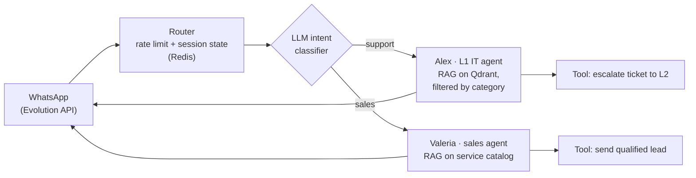
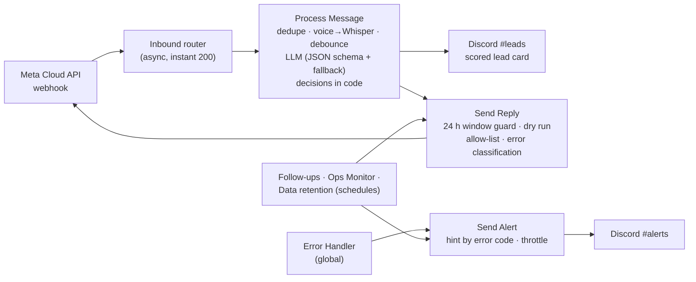
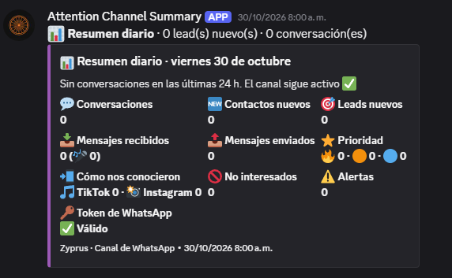

# WhatsApp AI Agents (n8n + LLMs)

Two generations of WhatsApp AI agents I designed and built on self-hosted n8n. The second one exists because of what the first one taught me.

| | [v1 · Multi-agent IT support](v1-multi-agent-it-support/) | [v2 · Lead-qualification channel](v2-lead-qualifier/) |
|---|---|---|
| What it does | An LLM routes each message to an L1 IT-support agent (RAG) or a sales agent | Qualifies inbound leads, asks for consent and posts scored leads to Discord |
| Status | Built for an acquaintance's IT services business; **never used** | **Deployed on the official WhatsApp number** (Oct–Nov 2026); **it never received real users** |
| In this repo | 5 importable n8n workflows | Spec, runbook, prompt, knowledge base and test results. The 10 workflow JSON files were **lost when I shut down the server** |

## v1 · Multi-agent IT support

## v2 · Lead-qualification channel

## What changed from v1 to v2

| | v1 | v2 |
|---|---|---|
| Errors | None handled: 0 of 41 nodes retry or route errors | Global error handler, alerts with a suggested action per error code, throttling, daily heartbeat |
| Testing | Manual | 27 documented scenarios through a test harness in dry-run mode, plus on-device acceptance rounds |
| LLM output | Free text from the agent | Strict JSON schema, model fallback, and the code (not the model) decides what happens |
| Sending | Several workflows call the WhatsApp API | One send path with the 24 h window guard, dry run and recipient allow-list |
| Settings & privacy | Hard-coded in nodes | Config table editable without redeploys; consent, opt-out, masked numbers, 12-month retention |

*The v2 monitor at work: the daily summary for 30 Oct 2026. It shows zero conversations because the channel was live but never got traffic.*

## Lessons

- **Reasoning models need token headroom.** In live testing, DeepSeek spent its whole token budget on hidden reasoning and returned an empty answer. An output auto-fixer that couldn't see the conversation then invented a reply in English and wiped lead data. Fix: more tokens, no context-free fixer, language and placeholder guards in code.
- **Let code make the decisions.** Lead fields are merged in code and never overwritten by model placeholders; the qualification gate is deterministic.
- **Export workflows to git.** I lost the v2 workflows with the server. Everything I build now lives in a repository.

## Stack

n8n (self-hosted) · JavaScript · OpenRouter (DeepSeek, MiniMax) · WhatsApp Cloud API and Evolution API · Qdrant · Hugging Face embeddings · Redis · PostgreSQL · Groq Whisper · Discord · Docker Compose · Caddy

v2 was built with an agentic workflow: Claude Code connected to n8n through MCP, guided by a written spec.

## License

[MIT](LICENSE)
